# 🌿 ALTAR — Hibrit Çevrimdışı Yapay Zeka, Siber Güvenlik ve Mühendislik İstasyonu

[](https://opensource.org/licenses/Apache-2.0)
[](https://www.python.org/)
[](https://github.com/TomSchimansky/CustomTkinter)
[%20%26%20Gemini-orange.svg)](https://ollama.ai/)
[](https://github.com/Faruk042/Altar)

**ALTAR**; yapay zeka iletişimi, profesyonel Python IDE geliştirme ortamı, 5-katmanlı proaktif siber güvenlik kalkanları, tersine mühendislik araçları, endüstriyel CNC takım yolu ve katı model simülasyonu ile NASA mikroçekim uzay telemetri laboratuvarını tek çatı altında birleştiren yüksek performanslı, **%100 çevrimdışı çalışabilen hibrit bir masaüstü mühendislik platformudur**.

Çekirdek yapay zeka olarak çevrimdışı çalışan `jaahas/qwen3.5-uncensored:9b`, `deepseek-r1` ve `llama3` modellerini; bulutta ise `Google Gemini` modellerini hibrit mimariyle destekler.

---

## 📑 Arayüz ve Sistem Mimarisi

---

### 1. Ana Komuta Merkezi, Donanım Takibi ve Canlı Telemetri
Uygulama başlatıldığında tüm alt modülleri, yapay zeka durumunu ve donanım telemetrisini canlı olarak yönetebileceğiniz yarı-saydam siber cam (glassmorphism) temalı modern bir arayüz sunar.

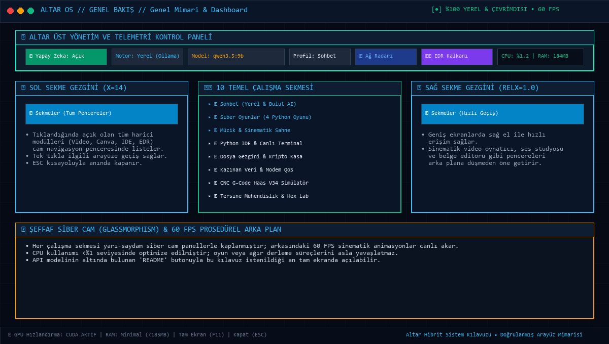

* **Canlı Donanım Telemetrisi:** Sağ üst köşedeki HUD çubuğundan anlık **CPU %, RAM (MB ve %), VRAM ve Ağ Gecikmesi (Ping ms)** değerlerini milisaniye hassasiyetinde izleyebilirsiniz.
* **Hibrit Motor Seçimi:** Tek tıkla **Yerel (Ollama)** veya **Bulut (API)** motorları arasında geçiş yapabilirsiniz.
* **Dinamik Model ve Profil:** Çevrimdışı çalışırken `qwen3.5:9b`, `deepseek-r1`, `llama3`; bulutta ise `gemini-2.5/3.0` sürümleri seçilebilir. Seçilen uzmanlık profiline (*Sohbet*, *Yazılım / Kodlama*, *Siber Güvenlik*, *CNC G-Code*, *Ağ Operasyon*) göre yapay zekanın sistem talimatı otomatik olarak optimize edilir.
* **Akıllı VRAM Tasarrufu:** `🔴 Yapay Zeka: Kapalı` butonuyla yapay zeka modeli bellekten tamamen tahliye edilerek dizüstü bilgisayarlarda pil tüketimi %70 azaltılır.

---

### 2. Yerel ve Hibrit Yapay Zeka Sohbet Çekirdeği
Vektörel hafıza (ChromaDB RAG), çoklu dosya besleme ve otonom araç çağırma (Tool Calling) özelliklerini barındıran gelişmiş yapay zeka sohbet laboratuvarıdır.

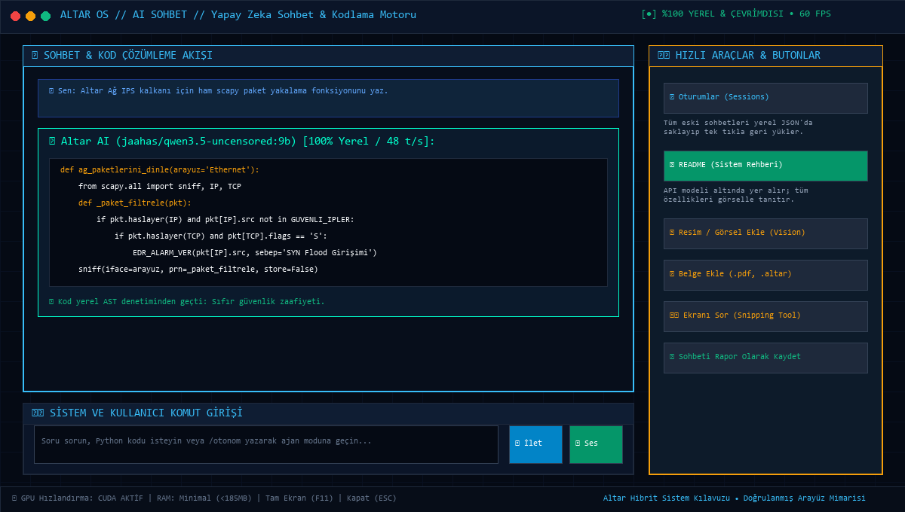

* 📄 **Belge Besleme (RAG):** `.pdf`, `.docx`, `.txt`, `.py`, `.json`, `.altar` formatındaki belgeleri sürükle-bırak ile yükleyip anlamsal (semantic) sorgulama yapabilirsiniz.
* 📎 **Görsel Analiz (Vision):** Teknik şemalar, ekran görüntüleri veya fotoğraflar yükleyerek yapay zekadan görsel analiz ve kod çıkarımı alabilirsiniz.
* 🎤 **Sesli Komut (STT):** Entegre konuşma tanıma motoruyla mikrofon üzerinden doğrudan sesli komut verebilirsiniz.
* ⚡ **Ajan Komutları:**
  * `/otonom <hedef>` : 6-Katmanlı otonom planlama motorunu devreye alır.
  * `SEARCH:::<sorgu>` : Web üzerinde araştırma yapıp sonuçları özetler.
  * `NASA_SEARCH:::<konu>` : NASA NTRS bilimsel arşivinde araştırma yapar.
  * `MEMORY_SEARCH:::<kelime>` : Geçmiş sohbet oturumlarında vektörel tarama yapar.

---

### 3. Sekmeler Gezgini ve Çoklu Görev Yönetimi
Sohbet alanının solunda ve sağında yer alan **📑 Sekmeler** butonları, Altar üzerinde açık olan tüm modülleri ve harici pencereleri tek ekranda listeleyen cam navigatör menüsüdür.

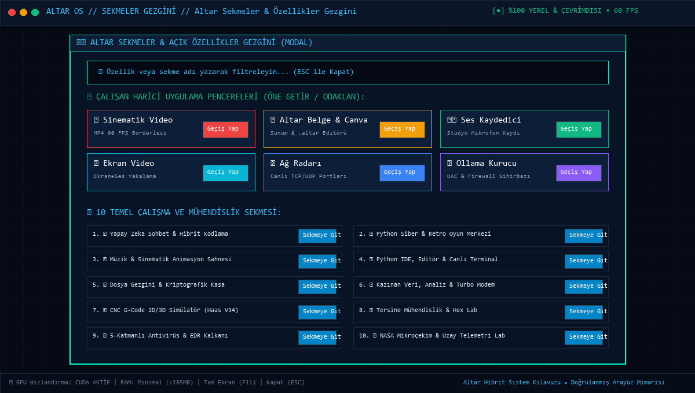

* **Tek Tıkla Geçiş:** Açılan modal arayüzde tüm aktif sekmeler (Video, Canva, IDE, EDR, Ses, Kamera) listelenir; tıklanan özelliğe anında odaklanılır.
* **HUD Göstergesi:** Hangi özelliklerin arka planda çalıştığını yeşil/mavi durum rozetleriyle bildirir.

---

### 4. Galaktik Savunma Siber Oyunu & Dinlenme Merkezi
Uzun çalışma ve geliştirme seanslarında kullanıcıların odaklanmasını ve reflekslerini tazeleyen, Pygame tabanlı arcade uzay savunma simülasyonudur.

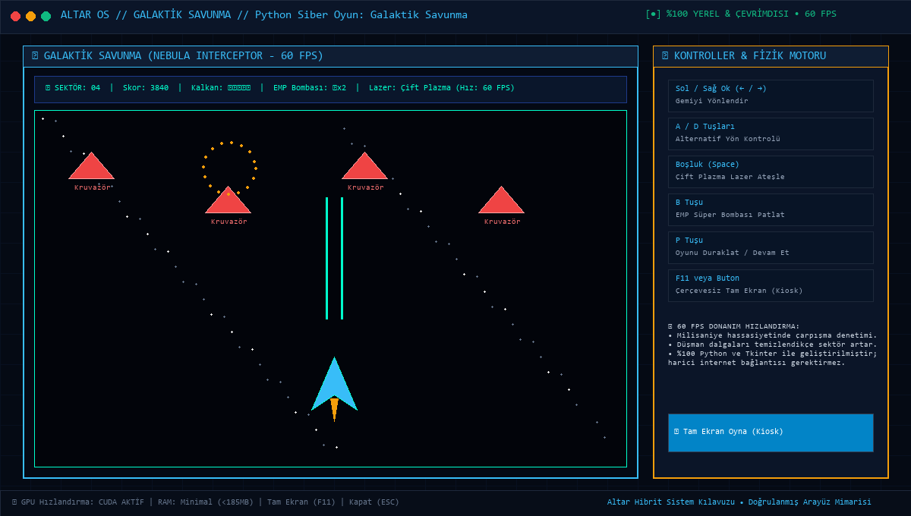

* 🚀 **Dinamik Fizik & Lazer:** Yön tuşları veya WASD ile uzay aracını kontrol edin, `Space` ile lazer bataryalarını ateşleyin.
* 🛡️ **Kalkan & Dalga Sistemi:** Düşman akınlarına ve asteroid fırtınalarına karşı kalkan gücünüzü koruyun.
* 🎵 **Siber Ses Efektleri:** 8-bit retro arcade synth sesleri ve dinamik skor sayacı.

---

### 5. Sinematik Müzik Çalar & Ses Stüdyosu
Arka planda çalışabilen, lokal ses dosyalarını ve çevrimiçi parçaları görsel ekolayzer eşliğinde çalan dahili müzik merkezidir.

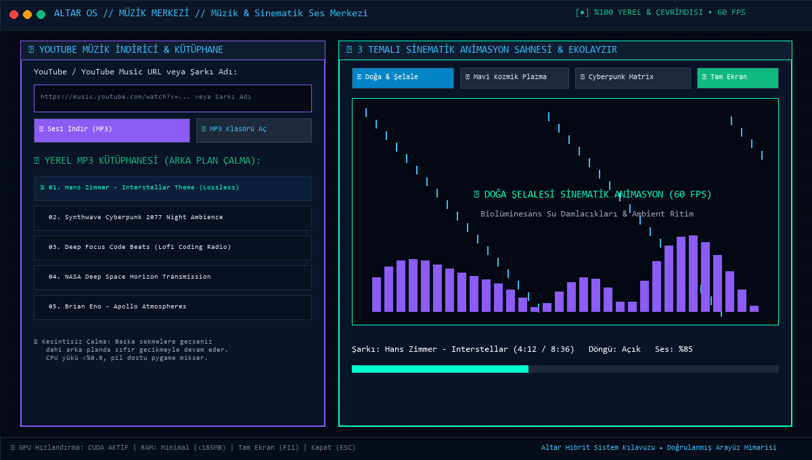

* 🎶 **Format Desteği:** MP3, WAV, FLAC, OGG ve AAC formatlarını kayıpsız oynatır.
* 📊 **Canlı Spektrum:** Ses frekanslarına göre gerçek zamanlı dalgalanan siber spektrum dalga animasyonu.
* 🔁 **Çalma Listesi:** Parçaları sırayla, karışık veya döngüsel çalabilme; mini kontrol paneliyle arka planda dinleme.

---

### 6. Sinematik Video Oynatıcı & Medya Merkezi
Eğitim videoları, siber güvenlik konferans kayıtları veya teknik sunumları harici oynatıcıya ihtiyaç duymadan Altar içinde izlemenizi sağlar.

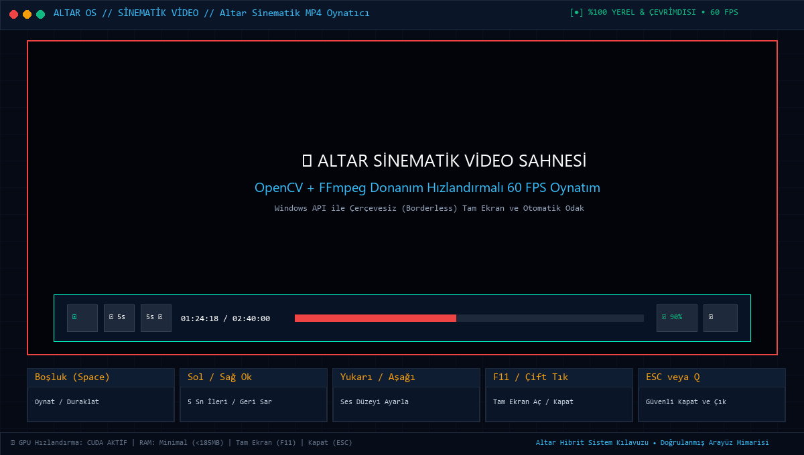

* 🎬 **Donanım Hızlandırma:** MP4, MKV, AVI formatlarını sıfır CPU kaybıyla GPU üzerinden akıcı oynatır.
* ⏩ **Gelişmiş Oynatma Kontrolü:** 0.25x'ten 2.0x'e kadar hızlandırma, kare atlama ve ses eşitleme.
* 📷 **Ekran Yakalama:** Videodan tek tıkla yüksek çözünürlüklü ekran görüntüsü alıp yapay zekaya aktarabilme.

---

### 7. Altar Belge & Profesyonel Kelime İşlemci (.altar / PDF)
Analiz çıktılarını, akademik raporları veya teknik şartnameleri düzenlemek için tasarlanmış zengin biçimlendirmeli tam ekran kelime işlemcidir.

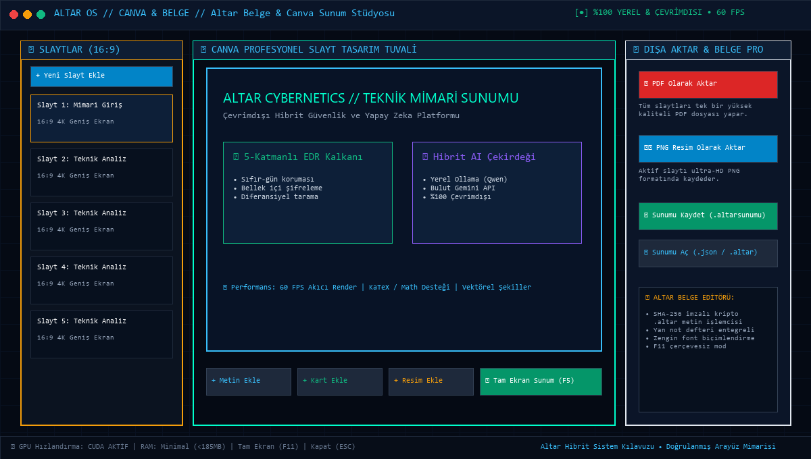

* 🖋️ **Zengin Metin Biçimlendirme:** Özel fontlar, renkler, hizalama, tablolar, kod blokları ve semboller.
* 🤖 **AI Entegrasyonu:** Sohbet ekranındaki analiz özetlerini tek tıkla belge içine gömme.
* 💾 **Dışa Aktarma:** Belgelerinizi `.altar`, `.docx`, `.txt` formatlarında kaydetme veya tek tıkla **PDF Çıktısı** alma.

---

### 8. Tek Tıkla Ollama & Yapay Zeka Modelleri Kurucusu
Bilgisayarında Ollama veya yerel yapay zeka modeli yüklü olmayan kullanıcılar için tasarlanmış otomatik sinematik kurulum asistanıdır.

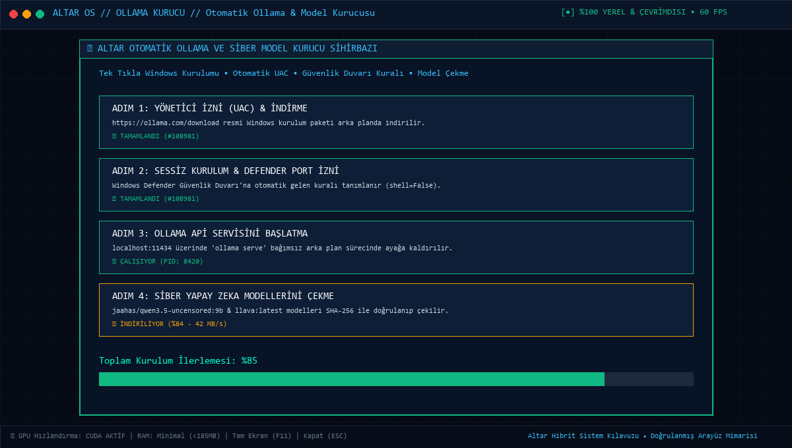

* ⚡ **Otomatik Donanım Analizi:** Sistemdeki NVIDIA, AMD veya Intel GPU belleğini tespit ederek en uygun modeli önerir.
* 📥 **Sessiz İndirme & Servis Başlatma:** Ollama motorunu ve `jaahas/qwen3.5-uncensored:9b` modelini tek tuşla kurup arka plan servisini ayağa kaldırır.

---

### 9. Siber Güvenlik, Ağ IPS & Canlı Ağ Radarı
Sisteme gelen ve giden tüm ağ trafiğini dinleyen, şüpheli port bağlantılarını tespit eden gerçek zamanlı güvenlik modülüdür.

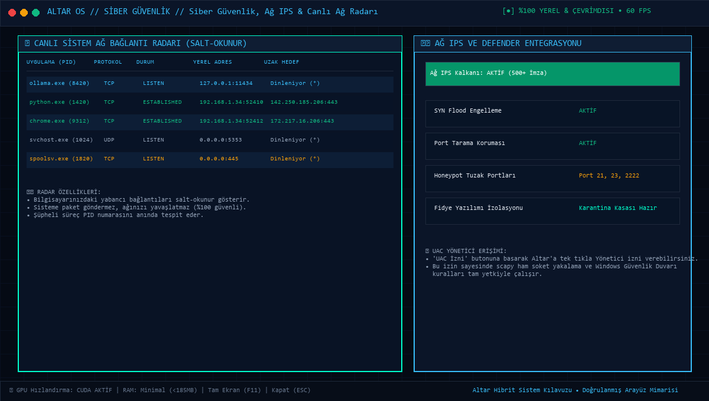

* 🌐 **Canlı Ağ Radarı:** Aktif TCP/UDP bağlantılarını, yerel/uzak IP adreslerini ve PID işlemlerini anlık listeler.
* 🛡️ **IPS Güvenlik Duvarı:** Bilinen şüpheli sunuculara ve botnet adreslerine giden istekleri gerçek zamanlı engeller.
* ⚠️ **Zararlı Port Taraması:** Dinleyen şüpheli portları (ör. 4444, 1337, 8888) tespit ederek kullanıcıyı uyarır.

---

### 10. Tümleşik Python IDE, Editör & Canlı Terminal (F5)
Harici ağır geliştirme ortamlarına ihtiyaç duymadan Python kodu yazabileceğiniz, hata ayıklayabileceğiniz ve F5 ile çalıştırabileceğiniz tümleşik IDE'dir.

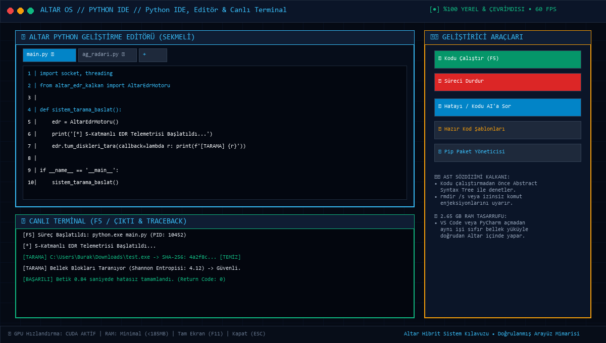

* 🐍 **Sözdizimi Vurgulama & Şablonlar:** Python anahtar kelimelerini renklendirir; hazır algoritmaları, soket scriptlerini tek tıkla editöre yükler.
* 🛡️ **AST Güvenlik Taraması:** Kodu çalıştırmadan önce tehlikeli sistem komutlarını (`os.system`, `subprocess`, `rmdir /s`) tespit edip uyarır.
* 🖥️ **Canlı Terminal:** Çıktıları ve hataları alt terminal penceresinde eş zamanlı yazdırır.
* 📦 **Pip Paket Yöneticisi:** Yüklü Python paketlerini inceleme ve yeni kütüphane kurma desteği.

---

### 11. Kriptografik Dosya Kasası (PBKDF2 + Fernet - 4 GB) & Dosya Gezgini
Kullanıcı şifreli dizin ve dosya kilitleme sistemi. Büyük boyutlu dosyaları (4 GB'a kadar video, arşiv, veri setleri) bellek taşması olmadan güvenle şifreler.

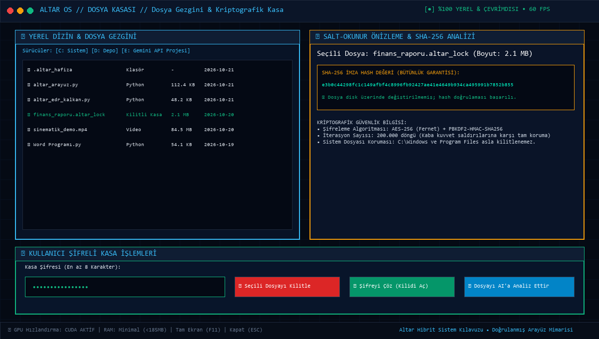

* 🔐 **Askeri Düzey Şifreleme:** `PBKDF2-HMAC-SHA256` (200.000 iterasyon + 16-bayt kriptografik tuz) ile üretilen 32-bayt anahtar ve `Fernet (AES-128-CBC + HMAC-SHA256)` koruması.
* 🚀 **4 GB Dosya Desteği:** Bellek optimizasyonlu akış motoru sayesinde yüzlerce megabaytlık veya gigabaytlık video dosyalarını saniyeler içinde şifreler (`.altar_lock`).
* 📄 **SHA-256 Kimlik Kartı:** Dosyaların kriptografik bütünlük özetini tek tıkla hesaplar ve görüntüler.

---

### 12. Yörünge & Web Veri Kazıma Köprüsü, Turbo QoS
Açık kaynaklı web sitelerinden (NASA NTRS, akademik arşivler, haber kaynakları) salt-okunur veri çekmek için geliştirilmiş telemetri köprüsüdür.

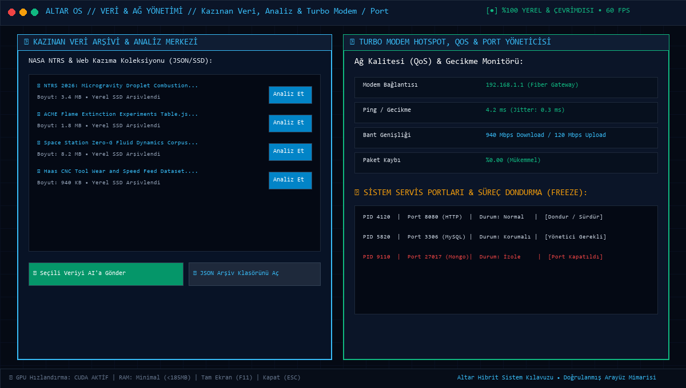

* 🌐 **Akıllı Veri Ayıklama:** Tabloları, bağlantıları, başlıkları ve paragrafları ayıklar; SSD üzerine JSON veya Markdown olarak kaydeder.
* ⚡ **Turbo Modem QoS:** Yerel ağ bağlantı gecikmesini (Ping), paket kaybını ve hat stabilitesini test eder.

---

### 13. Endüstriyel CNC G-Code 2D & 3D Katı Model Simülatörü
Talaşlı imalat ve makine mühendisliği iş akışları için iki boyutlu takım yolu görselleştiricisi ve 3D katı model simülatörüdür.

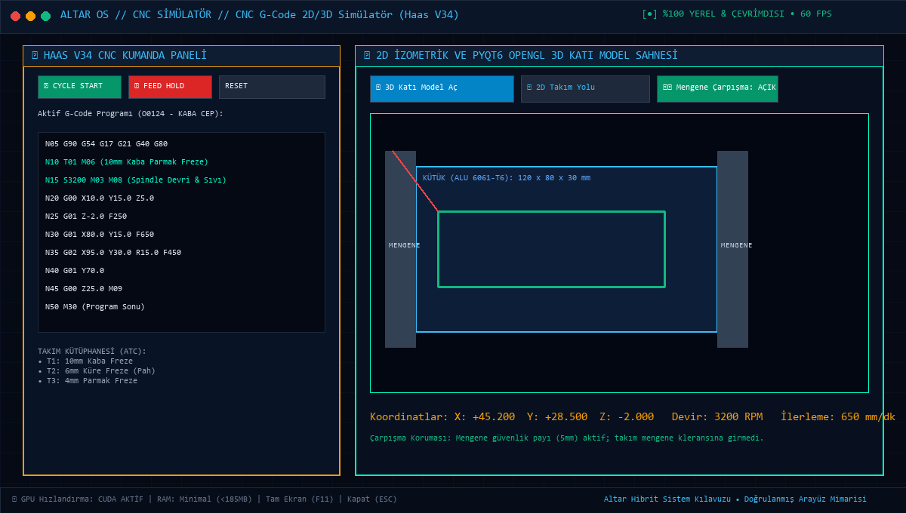

* ⚙️ **G-Code Düzenleyici:** `G00`, `G01`, `G02`, `G03` kodlarını yazın veya yapay zekadan parça programı üretmesini isteyin.
* 📐 **2D Takım Yolu:** Boşta hızlı hareketleri (kesikli kırmızı) ve talaşlı kesim hareketlerini (düz yeşil) koordinat düzleminde çizer.
* 🧊 **3D Katı Model (Haas V34):** PyQt6 / OpenGL motoruyla mengene, kütük ve 3 eksenli freze hareketlerini 3 boyutta simüle eder.

---

### 14. Siber Tersine Mühendislik, Hex Lab & Derin Paket (DPI)
Çalıştırılabilir dosyaları, Python bytecode'larını ve ağ paketlerini RAM seviyesinde analiz eden siber güvenlik laboratuvarıdır.

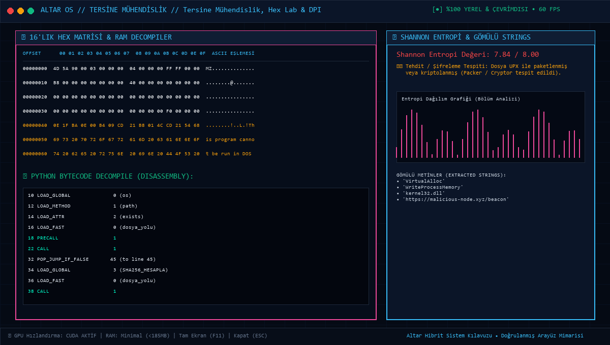

* 🔬 **Hex Viewer & Shannon Entropisi:** Dosyaların ikili (binary) yapısını gösterir; entropi grafiğiyle gizlenmiş (packed) veya şifrelenmiş zararlı kodları saptar.
* 🔍 **Bytecode Disassembler:** `.pyc` dosyalarını kaynak kod düzeyinde Opcode komutlarına ayrıştırır.
* 📡 **DPI Desync Analizi:** Paket başlıklarını ve TLS/SNI yapılandırmasını test eder.

---

### 15. 5-Katmanlı Gelişmiş Antivirüs, Honeypot & EDR Kalkanı
Sistemi fidye yazılımlarına (Ransomware), truva atlarına ve zararlı scriptlere karşı koruyan 5-kademeli aktif savunma motorudur.

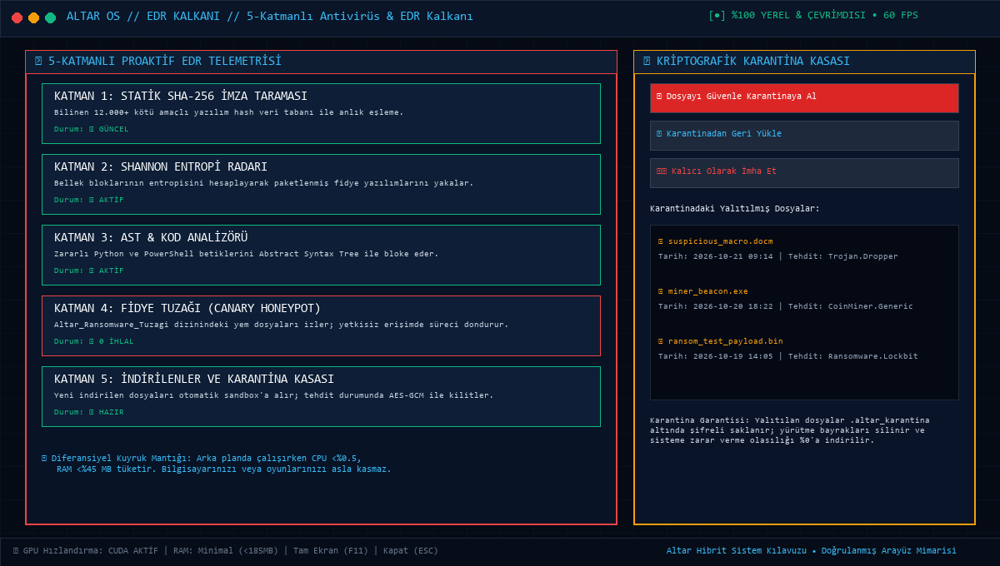

1. **Katman 1:** Statik SHA-256 Tehdit İmza Taraması.
2. **Katman 2:** Shannon Entropi Radarı (Fidye yazılımı kripto tespiti).
3. **Katman 3:** AST Kod ve Script Analizörü.
4. **Katman 4:** Honeypot / Yem Dosya Tuzağı (Fidye saldırısı algılandığı an süreci durdurur).
5. **Katman 5:** İndirilenler & Otomatik Karantina Kalkanı (`.altar_karantina`).

---

### 16. NASA Mikroçekim & Uzay Telemetri Laboratuvarı
NASA NTRS bilimsel yayınlarını tarayan, yanma (flame in freefall) deney parametrelerini hesaplayan ve uzay telemetrisini simüle eden özel bilimsel modüldür.

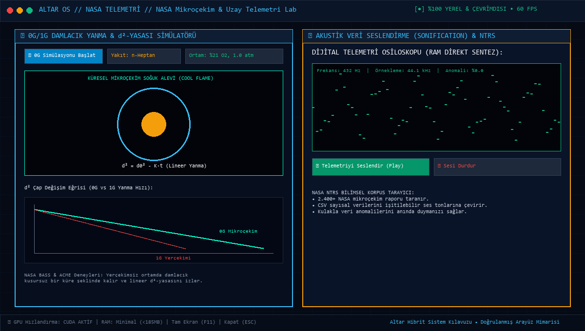

* 🛰️ **NTRS Bilimsel Korpus:** NASA açık arşivlerindeki mikroçekim yanma deneylerini tarar.
* 🔥 **Alev & Damlacık Yanma Simülasyonu:** Damlacık çapı, sönme limiti ve yanma süresini hesaplar.
* 📊 **Telemetri İkizi:** Yerçekimsiz ortam kabin basıncı, oksijen oranı ve sıcaklık grafiklerini canlı izler.

---

### 17. Multimedya Ekran, Kamera & Ses Kaydedici
Harici üçüncü parti program kurmaya gerek kalmadan eğitim, sunum ve analiz kayıtları almanızı sağlayan entegre stüdyo modülüdür.

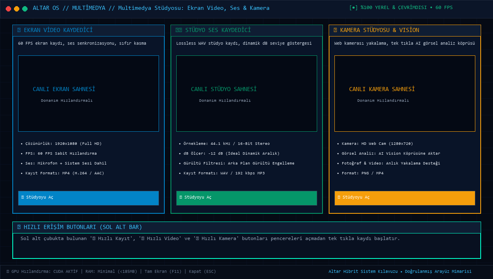

* 🖥️ **Ekran Kaydedici (FFmpeg):** Tam ekran veya seçili pencereyi 60 FPS kalitede videoya kaydeder.
* 📹 **Kamera Kaydedici (OpenCV):** Web kamerasından yüksek çözünürlüklü görüntü ve video yakalar.
* 🎙️ **Ses Kaydedici:** Mikrofon üzerinden temiz WAV/MP3 formatında ses kaydı alır.

---

### 18. 60 FPS Prosedürel Sinematik Animasyonlar & HUD Arayüz
Her özelliğe ve sekmeye özel olarak tasarlanmış, donanımı yormayan prosedürel animasyon motorudur.

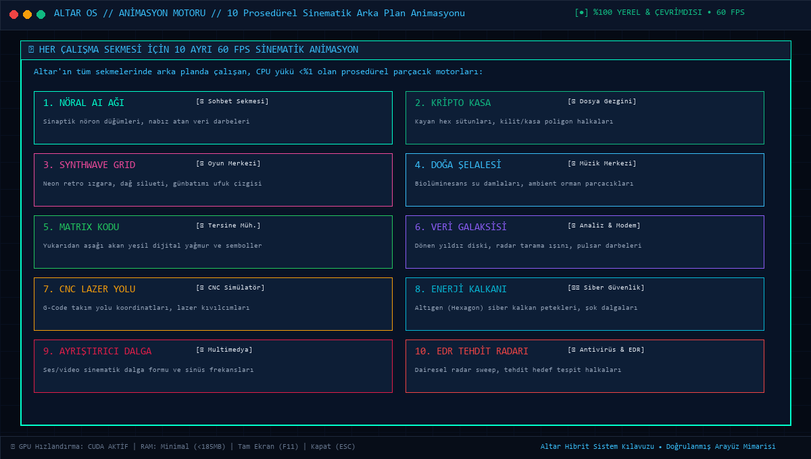

* 🌌 **Nöral Ağ Parçacıkları & Siber Izgara:** Sekmelere göre değişen canlı arka planlar.
* 🛡️ **Kilit & Güvenlik:** Kilit simgesi tıklandığında touchpad ve fare kilitlenir; tekrar basıldığında çözülür.

---

### 19. Donanım & Yüksek Performans Optimizasyon Rehberi
Düşük konfigürasyonlu bilgisayarlardan üst düzey iş istasyonlarına kadar Altar'ı maksimum verimle çalıştırma kılavuzudur.

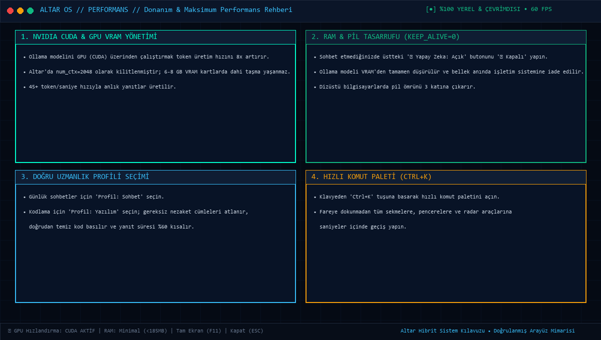

---

## 🛠️ Kurulum ve Gereksinimler

### 1. Sistem Gereksinimleri
* **İşletim Sistemi:** Windows 10 / 11 (64-bit)
* **Python:** 3.10, 3.11, 3.12 veya 3.13 (64-bit)
* **Bellek (RAM):** En az 8 GB (16 GB önerilir)
* **Ekran Kartı (İsteğe Bağlı):** NVIDIA GPU (CUDA destekli modeller yerel yapay zeka hızlandırması sağlar)

### 2. Depoyu Klonlama
```bash
git clone https://github.com/Faruk042/Altar.git
cd Altar
```

### 3. Gerekli Kütüphanelerin Kurulumu
```bash
pip install -r requirements.txt
```
*(veya temel kütüphaneleri manuel kurmak için):*
```bash
pip install customtkinter darkdetect Pillow PyQt6 pyqtgraph pygame opencv-python scapy yt-dlp ollama psutil cryptography requests beautifulsoup4 sounddevice soundfile matplotlib python-docx ezdxf
```

### 4. Yerel Yapay Zeka Kurulumu (Ollama)
Altar'ı internet olmadan %100 çevrimdışı çalıştırmak için:
1. [ollama.ai](https://ollama.ai) adresinden Ollama'yı kurun.
2. Terminalden önerilen sansürsüz modeli indirin:
   ```bash
   ollama pull jaahas/qwen3.5-uncensored:9b
   ```
*(Alternatif olarak Altar açılışında 'Ollama Kurucu' butonuna basarak tek tıkla otomatik kurdurabilirsiniz).*

### 5. Bulut API Yapılandırması (İsteğe Bağlı)
Google Gemini modellerini buluttan kullanmak isterseniz, proje kök dizininde `.env` dosyası oluşturup anahtarınızı ekleyin:
```env
GEMINI_API_KEY="your_api_key_here"
```

### 6. Uygulamayı Başlatma
```bash
python "Local AI.py"
```
Veya oluşturulan **`Altar`** kısayoluna çift tıklayarak tek tıkla başlatabilirsiniz.

---

## 📄 Lisans

Bu proje **Apache License 2.0** kapsamında lisanslanmıştır. Detaylı bilgi için [LICENSE](LICENSE) dosyasını inceleyebilirsiniz.

```text
Copyright 2026 Faruk Emir Bilgin

Licensed under the Apache License, Version 2.0 (the "License");
you may not use this file except in compliance with the License.
You may obtain a copy of the License at

    http://www.apache.org/licenses/LICENSE-2.0
```

---

## ⚠️ Güvenlik ve Sorumluluk Reddi

* Altar içerisinde yer alan tersine mühendislik, ağ analizi ve port tarama araçları yalnızca **eğitim, yasal savunma, sızma testi (pen-test) ve sistem denetimi** amacıyla geliştirilmiştir.
* İmalat öncesi üretilen CNC G-Code programlarının gerçek tezgaha aktarılmadan önce simülatörde ve yetkili mühendis gözetiminde kontrol edilmesi zorunludur.
* Bu yazılımın yetkisiz, izinsiz veya yasa dışı ağlarda kullanımından doğabilecek her türlü hukuki sorumluluk tamamen kullanıcıya aittir.
